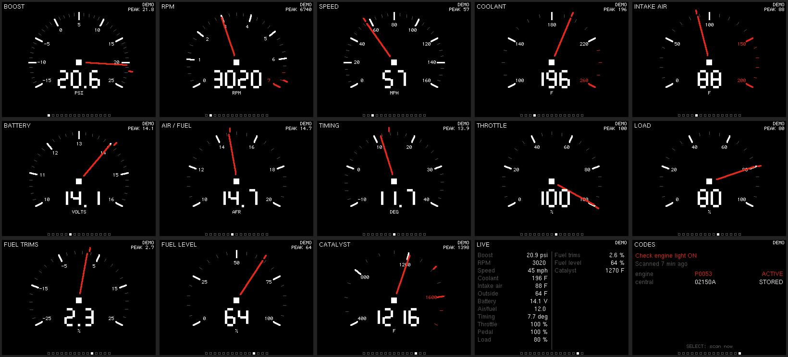

# OBDipodScanner

Car gauges and fault codes on an iPod classic. The iPod runs
[Rockbox](https://www.rockbox.org) with a plugin that shows full-screen gauges
fed live by [CANcarLogger](https://github.com/alsocat/CANcarLogger), an
ESP32-S3 that reads the car over CAN. The iPod plugs into the ESP32's USB port
with a normal iPod cable, and can be plugged in and pulled out whenever.



- **Gauges**, one per screen, scrolled with the click wheel: boost, rpm, speed,
  coolant, intake air, battery, air/fuel, timing, throttle, load, fuel trims,
  fuel level, catalyst. Each keeps a peak marker.
- **Live**: everything on one list.
- **Codes**: check-engine light, the last scan's fault codes per module, and
  Select starts a new scan, even while driving.

| Button | |
|---|---|
| Wheel, ⏮ / ⏭ | change page |
| Select | reset the peak; on Codes, scan now |
| Play | demo mode (made-up data, to try it without a car) |
| Menu | exit (the page is remembered) |

Tested on an iPod classic 120 GB (late 2008); every 6th gen classic uses the
same Rockbox build.

## How it connects

The ESP32 is the USB host. While the plugin is open, the iPod connects
charge-only (no disk mode screen) and offers a USB serial port; the ESP32 sends
it a line of live values every 50 ms and the fault code summary every 2 s,
and the iPod sends `SCAN` back when Select is pressed on the Codes page. On a
DevKitC the iPod gets its power from the ESP32's USB port, so it charges while
you drive.

If the iPod is plugged in before the plugin is open, Rockbox goes to its disk
mode screen as usual: unplug, open the plugin, plug back in. Unplug the iPod
when you park, or it keeps charging from the car while the ESP32 sleeps (or
fit a 5 V switch, see CANcarLogger's `OBD_USB_VBUS_GPIO`).

The plugin also reads the dock connector's serial pins (57600 8N1, 3.3 V), if
you'd rather wire that than use USB.

## What the patches change

Against Rockbox `7d090f2` (`patches/`, applied by `build.sh`):

1. iPod 6G: a plugin can take the dock serial port's receive side away from
   iAP (`serial_raw_rx`, `serial_raw_read`).
2. The same buffer is fed by Rockbox's USB serial (CDC-ACM) class, which is
   switched on for the 6G; while a plugin holds the port, plugging in USB stays
   charge-only so the plugin keeps running. `serial_raw_write` sends back.
3. The plugin itself (`apps/plugins/boost_gauge.c`, also in `plugin/`).
4. A fix to Rockbox's USB serial driver: it only took 32 bytes per USB packet,
   so longer lines from a host were lost.
5. Plugin text for scans while driving.

The plugin API version goes up, so use the whole build, not just the plugin.

## Build

```sh
# once: Rockbox's ARM cross compiler (takes a while)
git clone https://github.com/Rockbox/rockbox.git /tmp/rb && /tmp/rb/tools/rockboxdev.sh --target=a --prefix=$HOME/.local/rockbox-tc
export PATH=$HOME/.local/rockbox-tc/bin:$PATH

./build.sh      # -> out/rockbox.zip, out/bootloader-ipod6g.ipod, out/mks5lboot
```

Prebuilt files are on the releases page.

## Install

1. The iPod must be Windows formatted (FAT32). A Mac formatted one (HFS+),
   or one with old firmware, needs a Restore in iTunes on **Windows** first.
   That erases it.
2. Copy the `.rockbox` folder from `rockbox.zip` to the root of the iPod and
   eject it.
3. Put the iPod in DFU mode: hold **Select + Menu** for about 12 seconds,
   until the screen stays black. Then:

   ```sh
   sudo ./mks5lboot --bl-inst bootloader-ipod6g.ipod
   ```

   A two-tone beep and it reboots into Rockbox.

The bootloader is dual boot: hold **Menu** while it starts to get Apple's
firmware. `mks5lboot --bl-uninst ipod6g` removes it.

## Data format

Lines of space-separated `key=value` integers, one letter per value:

| | | | |
|---|---|---|---|
| `B` boost, 0.1 psi | `R` rpm | `S` speed, km/h | `C` coolant, °C |
| `I` intake air, °C | `T` throttle, 0.1 % | `P` pedal, 0.1 % | `L` load, 0.1 % |
| `A` timing, 0.1° | `V` battery, 0.01 V | `F` fuel level, 0.1 % | `M` lambda, 0.001 |
| `E` short trim, 0.1 % | `G` long trim, 0.1 % | `K` catalyst, °C | `O` outside, °C |

Fault codes come as `@D mil=1 age=125 engine:P0053:A central:02150A:S`:
`mil` -1 = not read yet; `age` = seconds since the scan (-1 none, -2 from an
earlier drive); `scan=3/15` while one runs; flags A active, P pending, S stored.

## License

GPL v2, like Rockbox.
